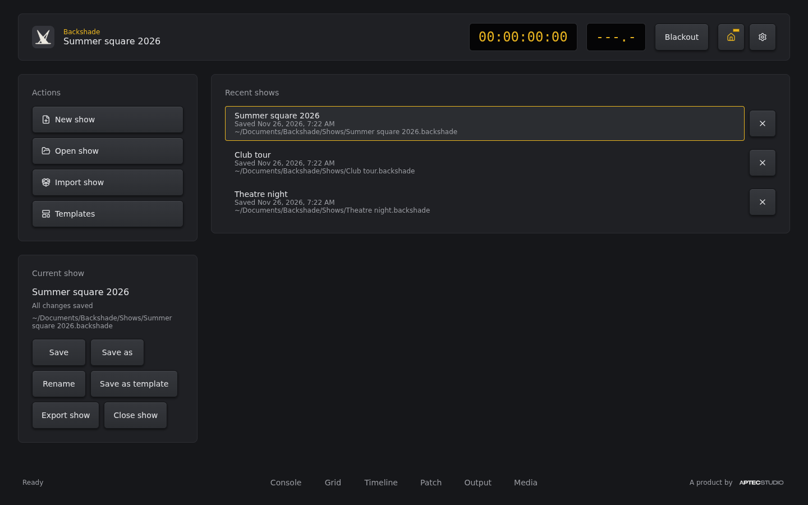
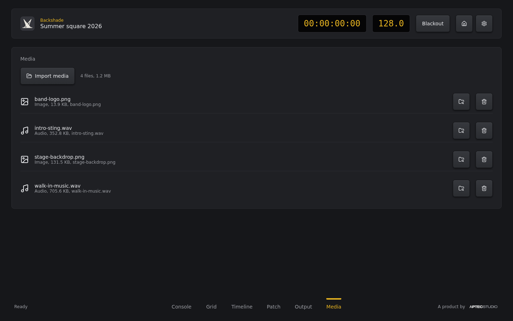
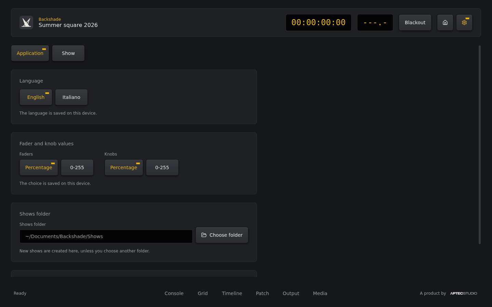

# Backshade

Programming console for live shows: lights, audio and video in one simple application.

A product by [Aptec Studio](https://www.aptecstudio.com).

Backshade is a cross-platform desktop application (Windows, Linux, macOS) built on Electron, with a web interface that can also be used from other devices on the local network.

## Screenshots

The start page opens at launch, with the recent shows and the actions on the open show.



New shows start from a template: the included "Empty show" or one saved by the user.


Every show keeps its audio, video and image files in its own folder.



Times are set with a time picker and a jog wheel, which works with mouse, pen and touch.


Application settings: language, display of fader and knob values, default shows folder.



Console controls from the component catalog: channel displays, knobs, square keys, long faders and typed values.


## Features

Available now:

- Start page with recent shows, as the entry point of the application
- Shows saved as portable folders: new, open, save, save as, rename, close
- Autosave with recovery after an unexpected exit, and history of the saved versions
- Show templates: included and created by the user, with a management screen
- Export and import of shows (`.bshow`) and templates (`.btemplate`) as single archives
- Show media: audio, video and image files copied into the show folder
- Show settings: description and notes, timecode frame rate, default fades
- Multilingual interface (English and Italian), extensible with language packs installed by the user
- Skeuomorphic console controls: keys, displays, knobs, faders, time picker, color wheel

Planned (see [ROADMAP.md](ROADMAP.md)):

- Multi-universe DMX and Art-Net fixtures
- LED matrices
- Simple console, a hybrid of live operation and programming, with scenes and chasers
- Virtual console on a customizable grid for each show
- Video direction, audio playback, overlay images and text gobos
- Pre-programmed shows with a DAW-style track editor
- Integration between lights, audio, video and external audio mixers
- Remote control from desktop or mobile through the built-in web server
- 3D stage, videomapping, several synchronized machines
- Touch screens and external MIDI controllers

## Requirements

- [Node.js](https://nodejs.org) 22.18 or later (the build scripts are TypeScript files run directly by Node) and npm
- Git
- Windows, macOS or Linux; on Linux the usual libraries needed by Electron (GTK 3, NSS, ALSA)

## Dependencies

Backshade uses as few dependencies as possible: everything the application needs at runtime is built on Electron, Node.js and browser APIs, or is part of the project, with one exception.

Runtime dependency (in `app/package.json`):

| Package | Version | Purpose |
| --- | --- | --- |
| `@serialport/bindings-cpp` | 13.0.1 | Native access to the serial ports, for USB DMX interfaces (Enttec DMX USB Pro, Open DMX); prebuilt N-API binaries, no rebuild for Electron |

Development dependencies (in `app/package.json`, installed with `npm ci`):

| Package | Version | Purpose |
| --- | --- | --- |
| `electron` | 45.4.1 | Application runtime |
| `typescript` | 7.0.2 | TypeScript compiler (`tsc`) for the application, the internal framework and the build scripts |
| `sass` | 1.108.2 | SCSS compiler (Dart Sass) for the styles |

Bundled in the repository:

- [Lucide](https://lucide.dev) icons 1.78.0 (ISC license), one SVG file per icon in `app/assets/icons/lucide`, turned into a sprite at build time.

Built inside the project, without external libraries:

- the internal TypeScript and SCSS frameworks in `app/src/framework`, used instead of UI libraries;
- the ZIP reader and writer used by the `.bshow` and `.btemplate` archives, on Node.js `zlib`.

## Build and run

All commands run in the `app` folder.

```sh
git clone https://github.com/aptecstudio/Backshade.git
cd Backshade/app
npm ci
npm start
```

`npm start` builds the application and launches it. The compiled files go to `app/dist`, which is not committed.

Other commands:

| Command | What it does |
| --- | --- |
| `npm run build` | Builds everything into `app/dist`: icons, language packs, main process, interface, styles and static files |
| `npm start` | Builds and launches the application |
| `npm run catalog` | Builds and opens the component catalog instead of the main page (development only) |
| `npm run check:scripts` | Type-checks the build scripts in `app/scripts` |

Partial builds, useful during development: `npm run build:icons`, `npm run build:locales`, `npm run build:node`, `npm run build:web`, `npm run build:styles`, `npm run build:static`.

If Electron starts as a plain Node.js process (for example in some editor terminals that set `ELECTRON_RUN_AS_NODE=1`), unset the variable before launching:

```sh
env -u ELECTRON_RUN_AS_NODE npm start
```

Installers for Windows, macOS and Linux are planned in Phase 11 of the roadmap.

## Where Backshade keeps its data

- Shows: `Documents/Backshade/Shows` by default, changeable in the settings.
- Application data (settings, recent shows, user templates and language packs): the Electron user data folder, for example `~/.config/Backshade` on Linux, `%APPDATA%\Backshade` on Windows and `~/Library/Application Support/Backshade` on macOS.

## Status

Phases 1 and 2 of the [roadmap](ROADMAP.md) are complete: application base, design system, localization, transport layer between interface and engine, shows, templates, media and archives. The next phase is DMX and Art-Net. Version 1.0.0 will be the first release, when all the planned features are ready for distribution and testing.

## Development documentation

- [AGENTS.md](AGENTS.md): rules for AI agents
- [ROADMAP.md](ROADMAP.md): phases and progress
- [MEMORY.md](MEMORY.md): choices and conventions
- [docs/design](docs/design/README.md): design reference
- [docs/brand](docs/brand/README.md): brand assets
- [docs/localization](docs/localization/README.md): languages and language packs

## License

Copyright (C) 2026 Aptec Studio.

Released under the [GNU General Public License v3.0](LICENSE).
