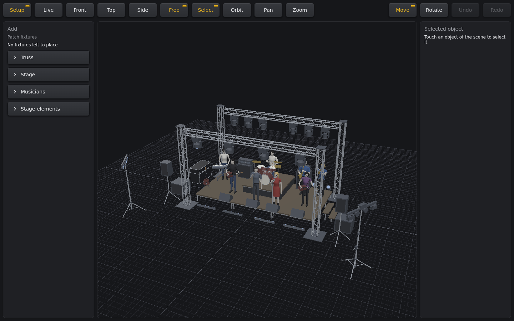
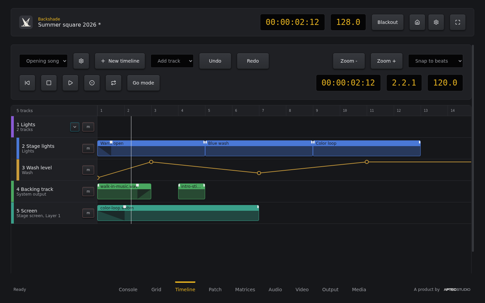
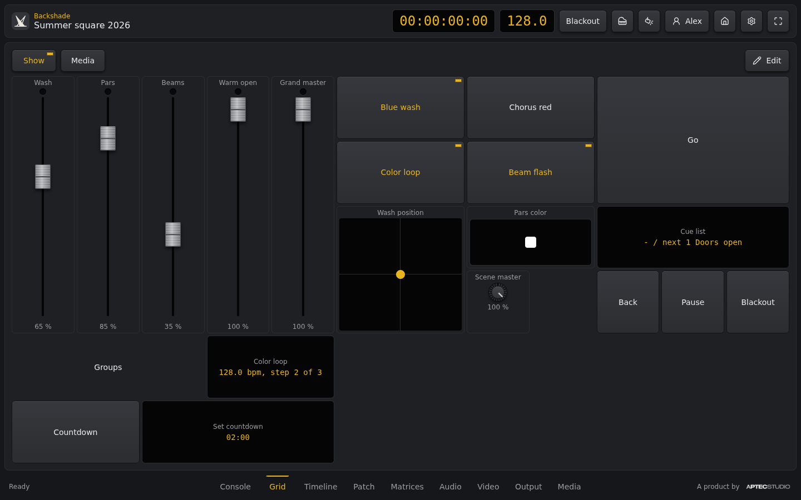
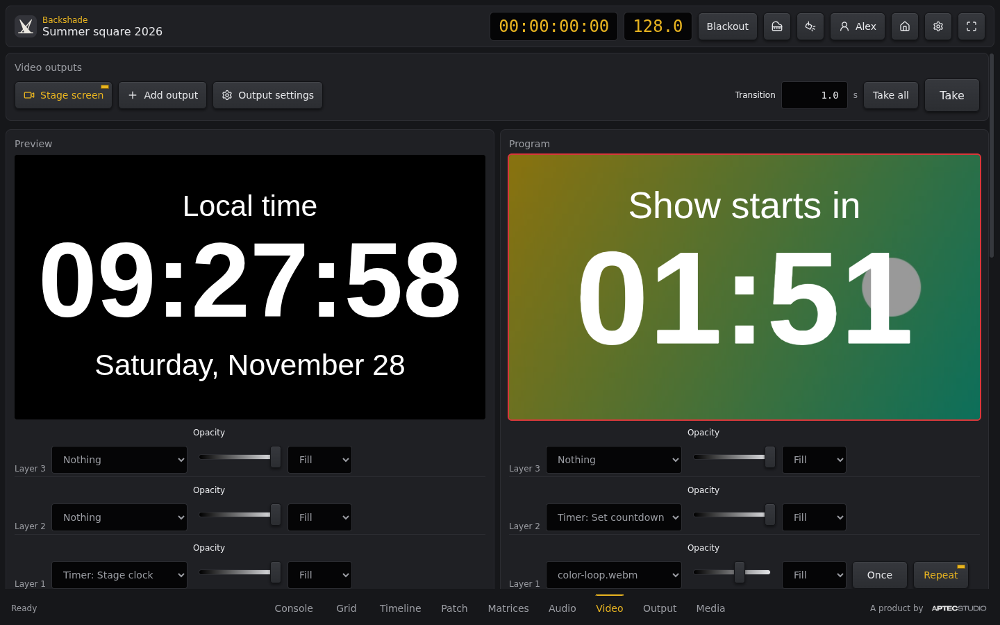
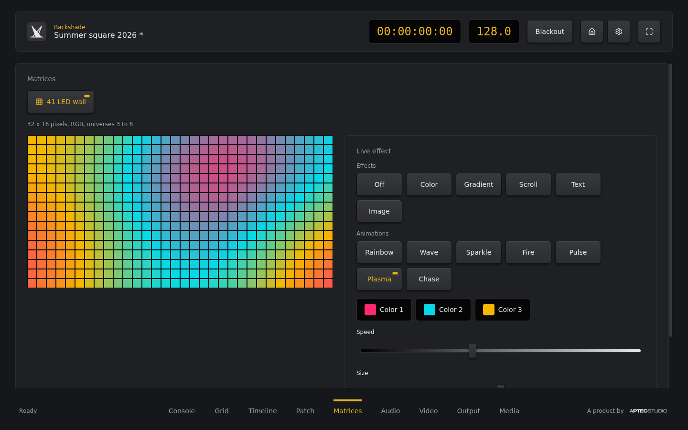

<p align="center">
  
</p>

<h1 align="center">Backshade</h1>

<p align="center">
  Programming console for live shows: lights, audio and video in one simple application.
</p>

<p align="center">
  A product by <a href="https://www.aptecstudio.com">Aptec Studio</a>.
</p>

---

Backshade is a cross-platform desktop application (Windows, Linux, macOS) built on Electron, with a web interface that can also be used from other devices on the local network.

## Screenshots

The 3D stage: truss, decks, musicians and the fixtures of the patch placed in real scale, in its own window.



Pre-programmed shows on a timeline of tracks: light, automation, audio and video clips on a shared clock, with folders, fades and snap to the beat.



The virtual console: a grid of faders, keys, an XY pad, a color picker, knobs and monitors, linked to groups, scenes, chasers and the cue list, for touch screens too.



Video direction with preview and program: layers of videos, images, text gobos and timer screens, taken to the outputs with a transition.



LED matrices patched over several universes, with live effects and animations whose colors can be chosen.



The simple console: a two-preset desk with Preset A and B rows of faders named after the patched fixtures, and the masters with the A/B crossfade.


## Features

Available now:

- Start page with recent shows; shows saved as portable folders, with autosave, recovery and history of the saved versions
- Show templates, with a complete "Demo show" to try every feature; export and import of shows and templates as single archives, show media in the show folder
- Show operators with a 4 digit PIN, mandatory in every show: each operator sees the sections of the profile, hidden, read only or editable
- Import from another show: scenes, chasers, fixtures, audio, video, images, operators and the 3D stage, with their dependencies and the choice of how to solve conflicts
- Fixture library with a custom fixture editor (gobo masks, prisms, dimmer curves), with definitions kept in the show and, on request, in a personal library for all the shows; multi-universe patch with groups and LED matrices
- DMX output over Art-Net and USB DMX interfaces, with grand master, blackout and a DMX monitor
- Simple console: two-preset desk, attributes panel with jog wheels and color wheel, scenes, chasers with tap tempo, live cues
- LED matrices with effects, animations and image mapping, recorded in scenes
- Virtual console on a customizable grid for each show, with multi-touch
- Audio player with playlist, fades and output device; video outputs on external displays with layers, inputs from cameras, preview and program, text gobos and timer screens
- Videomapping on the video outputs: surfaces with corner pin and crop, edited live with test images
- Timelines of tracks with lights, audio, video and automation clips, edited as in a DAW, with waveforms, markers, go mode, recording of live actions and MIDI timecode
- External audio mixers over OSC and MIDI; MIDI controllers with learn and feedback
- Remote control from other devices through the built-in web server, with the address as a QR code
- 3D stage in real scale: library of trusses, stage elements, fixtures and musicians, your own `.obj` models, hanging and mounting, and a live view of the fixtures from the DMX output with beams, gobos, prisms, effects and shadows
- Multilingual interface (English and Italian), extensible with language packs

Planned (see [ROADMAP.md](ROADMAP.md)):

- Video outputs in the 3D stage
- Mesh warp, masks, edge blending, 3D and pixel mapping; several synchronized machines
- Layout for phones, OSC control surfaces and installers

## Requirements

- [Node.js](https://nodejs.org) 22.18 or later (the build scripts are TypeScript files run directly by Node) and npm
- Git
- Windows, macOS or Linux; on Linux the usual libraries needed by Electron (GTK 3, NSS, ALSA)

## Dependencies

Backshade uses as few dependencies as possible: everything the application needs at runtime is built on Electron, Node.js and browser APIs, or is part of the project, with one exception.

Runtime dependency (in `app/package.json`):

| Package | Version | Purpose |
| --- | --- | --- |
| `@serialport/bindings-cpp` | 13.0.1 | Native access to the serial ports, for USB DMX interfaces (Enttec DMX USB Pro, Open DMX); prebuilt N-API binaries, no rebuild for Electron |

Development dependencies (in `app/package.json`, installed with `npm ci`):

| Package | Version | Purpose |
| --- | --- | --- |
| `electron` | 45.4.1 | Application runtime |
| `typescript` | 7.0.2 | TypeScript compiler (`tsc`) for the application, the internal framework and the build scripts |
| `sass` | 1.108.2 | SCSS compiler (Dart Sass) for the styles |
| `@types/three` | 0.187.0 | TypeScript types of three.js |

Bundled in the repository:

- [Lucide](https://lucide.dev) icons 1.78.0 (ISC license), one SVG file per icon in `app/assets/icons/lucide`, turned into a sprite at build time.
- [three.js](https://threejs.org) 0.187.0 (MIT license), the files used by the 3D stage in `app/vendor/three`.

Built inside the project, without external libraries:

- the internal TypeScript and SCSS frameworks in `app/src/framework`, used instead of UI libraries;
- the ZIP reader and writer used by the `.bshow` and `.btemplate` archives, on Node.js `zlib`.

## Build and run

All commands run in the `app` folder.

```sh
git clone https://github.com/aptecstudio/Backshade.git
cd Backshade/app
npm ci
npm start
```

`npm start` builds the application and launches it. The compiled files go to `app/dist`, which is not committed.

Other commands:

| Command | What it does |
| --- | --- |
| `npm run build` | Builds everything into `app/dist`: icons, language packs, main process, interface, styles and static files |
| `npm start` | Builds and launches the application |
| `npm run catalog` | Builds and opens the component catalog instead of the main page (development only) |
| `npm run check:scripts` | Type-checks the build scripts in `app/scripts` |

Partial builds, useful during development: `npm run build:icons`, `npm run build:locales`, `npm run build:node`, `npm run build:web`, `npm run build:styles`, `npm run build:static`.

If Electron starts as a plain Node.js process (for example in some editor terminals that set `ELECTRON_RUN_AS_NODE=1`), unset the variable before launching:

```sh
env -u ELECTRON_RUN_AS_NODE npm start
```

Installers for Windows, macOS and Linux are planned in Phase 11 of the roadmap.

## Where Backshade keeps its data

- Shows: `Documents/Backshade/Shows` by default, changeable in the settings.
- Application data (settings, recent shows, user templates and language packs): the Electron user data folder, for example `~/.config/Backshade` on Linux, `%APPDATA%\Backshade` on Windows and `~/Library/Application Support/Backshade` on macOS.

## Status

Phases 1 to 7 of the [roadmap](ROADMAP.md) are complete, with the first part of Phase 8: shows, operators and import between shows, fixtures and patch, DMX output, the simple console, LED matrices, the virtual console, audio and video, and the track timeline. Version 1.0.0 will be the first release, when all the planned features are ready for distribution and testing; the live tests to run before it are listed in [TESTING.md](TESTING.md).

## Development documentation

- [AGENTS.md](AGENTS.md): rules for AI agents
- [ROADMAP.md](ROADMAP.md): phases and progress
- [MEMORY.md](MEMORY.md): choices and conventions
- [TESTING.md](TESTING.md): final live tests with real hardware
- [docs/design](docs/design/README.md): design reference
- [docs/brand](docs/brand/README.md): brand assets
- [docs/localization](docs/localization/README.md): languages and language packs

## License

Copyright (C) 2026 Aptec Studio.

Released under the [GNU General Public License v3.0](LICENSE).
