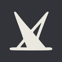
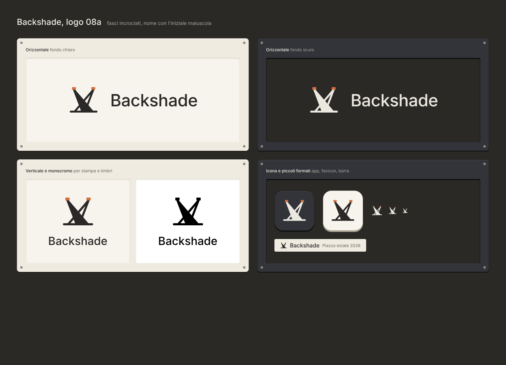

# Backshade brand assets

Backshade is a product of [Aptec Studio](https://www.aptecstudio.com). The Aptec Studio assets in this folder come from the `aptecstudio/woojam` repository.

## Aptec Studio wordmark

- File: `aptecstudio-wordmark.png`, PNG with transparency, 1080 x 200 px.
- Light letters: use it only on dark backgrounds (for example the chassis color `#2a2926`).
- Display height: `16` px in the application, `18` px on the landing site.
- Always link it to `https://www.aptecstudio.com` with the alternative text `Aptec Studio`.

## Credit line

- Italian: "Un prodotto Aptec Studio", followed by the wordmark.
- English: "A product by Aptec Studio", followed by the wordmark.
- Copyright: "Copyright (C) 2026 Aptec Studio".

## Backshade logo

The official logo is in [`docs/logo/`](../logo/README.md), together with the derived platform and web icons.

### Earlier reference (superseded)

The section below documents the design reference that preceded the official logo. It is kept for history only.

Reference for the chosen direction, "08a crossed beams": two stage beams crossing on the floor, one filled and one outlined, with the two fixtures in the accent color. The name is written "Backshade", with a capital initial.

Open [logo-reference.html](logo-reference.html) in a browser to inspect it.

- Versions shown: horizontal on light and dark backgrounds, vertical, monochrome, app icon (dark and light), small sizes at 32, 24 and 16 px, title bar example.
- Mark: 48 x 48 grid, stroke width 3 with round caps and joins; ink `#2a2927` on light, `#ebe8e0` on dark, fixtures in the accent `#d0703c`; all black in the monochrome version.
- Name: Archivo, width 125 (expanded), weight 500.
- **Font note:** the PNG was rendered without access to Google Fonts, so the name appears in a substitute system font, not in Archivo expanded. The HTML page loads Archivo from Google Fonts and shows the intended lettering when opened with an internet connection.

This is a design reference, not the final asset set: the final SVG, PNG and platform icons will be produced later, on request.

The logo was designed on a Claude design canvas: [Backshade - proposte logo](https://claude.ai/artifact/TyhC1KiKuPKozHbZnXQGD5) (private, visible to the owner unless shared).
