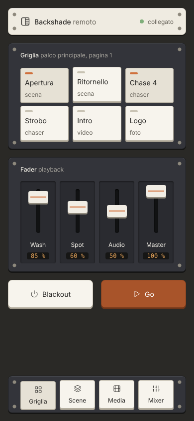

# Backshade design reference

Visual reference for the Backshade interface. It is the approved design draft and the starting point for the design system built in Phase 1 (see `ROADMAP.md`, item 1.4).

The files in this folder are a reference only: they are not application code and do not follow the ES5 rules of `/app`.

## Screens

### Console (desktop)

Simple console, a hybrid of live operation and programming: show status, sections, timecode and tempo, network outputs, blackout, fixture selection, programmer, scenes and chasers, playback faders and audio master.

Open [console.html](console.html) in a browser to inspect it.

### Track timeline (desktop)

DAW-style editor for pre-programmed shows: transport, zoom and snap, tracks for lights, chasers, LED matrix, audio, video, overlay images and external mixer automation on a shared clock.

Open [timeline.html](timeline.html) in a browser to inspect it.

### Remote (mobile)

Web interface served on the local network: virtual grid keys, playback faders, blackout and go.

Open [remote-mobile.html](remote-mobile.html) in a browser to inspect it.

## Visual model

Hardware skeuomorphism, as a hybrid with a modular hardware panel reference chosen by the human (the reference image is not stored in the repository). Elements taken from the reference:

- cream and anthracite panels with a screw in each corner;
- recessed LCD displays (green-grey) and segment displays (amber digits on black);
- knobs with a dotted scale and an indicator line;
- physical keycaps with a small LED strip, raised when off and pressed when active;
- faders with a light cap, an accent line and an LED meter;
- analog VU meters with a cream face;
- toggle switches with a status LED.

Adapted to the project rules in `AGENTS.md`: no uppercase labels, no glow, neutral palette with a single soft accent, only ASCII characters and accented letters.

## Tokens

### Spacing

Multiples of 8 only: `8, 16, 24, 32, 48, 64` px. Panels use `24` px padding so the corner screws do not overlap the content.

### Colors

| Role | Value |
| --- | --- |
| Chassis background | `#2a2926` |
| Cream panel | `#efebe1`, border `#c9c3b4` |
| Anthracite panel | `#33343a`, border `#1b1c1e` |
| Cream keycap | `#f7f4ed`, pressed `#e6e1d5`, shadow `#a9a294` |
| Dark keycap | `#4a4b51`, shadow `#18191b` |
| Text on cream | `#2a2927`, secondary `#6b675e` |
| Text on anthracite | `#ebe8e0`, secondary `#a8a59d` |
| LCD display | background `#c6cbb0`, text `#2b3024` |
| Segment display | background `#161615`, digits `#e3a25a` |
| Scope and monitor screens | background `#1c2420`, lines `#b9d2b4` |
| Accent (LEDs, indicators) | `#d0703c` |
| Accent key with text | `#a8542a`, text `#ffffff` |
| Status ok | `#7fae7a` |
| LED meter on | `#8fb08a`, peak uses the accent |
| Screws | `#8e897d` |

### Typography

- Text: `system-ui`, weights `400` and `500` only.
- Values, displays and addresses: system monospace.
- Panel labels: `12` px, title in `500` followed by a secondary word in `400` (for example "Programmer attributi live").

### Icons

Lucide line icons, `16` px (`20` px on mobile), stroke width `1.5`.

## Source

The screens were designed on a Claude design canvas. These HTML files are static exports of that canvas:

- [Backshade - bozza grafica](https://claude.ai/artifact/HLRQ26ymWZ4WZRd1CWPqqC) (private, visible to the owner unless shared)
