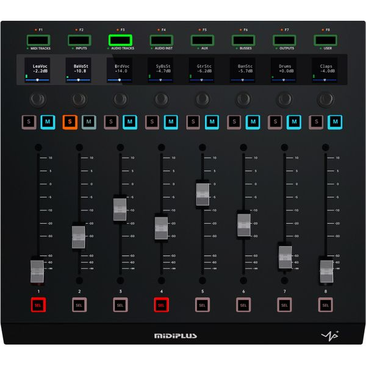
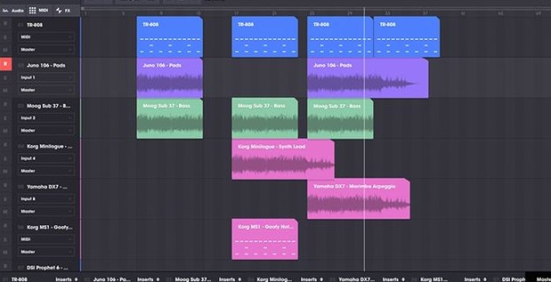
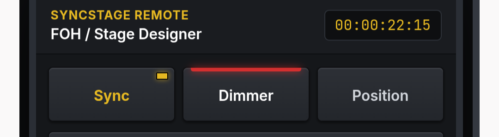

# Backshade design references

Visual references chosen by the human for the Backshade interface. They replace the earlier design drafts and are the starting point for the design system built in Phase 1 (see `ROADMAP.md`, item 1.4).

These images are references for style and layout only. Backshade does not copy their brands, names or exact layouts, and it keeps the project rules in `AGENTS.md`: no uppercase text, no glow, only ASCII characters and accented letters, line icons from one library.

## Hardware controller

Reference for the console surface and the channel strips.

- Smooth dark body, flat, with no visible panel decoration.
- One column per channel: small display with name and value, knob, two square keys, long fader, select key, channel number.
- Small per-channel displays: dark screen, light text, name on the first line and value on the second, thin level bar.
- Small dark knobs with a knurled edge.
- Square keys with a colored outline or backlight to show their state.
- Long, thin fader slots with a printed scale (numbers and ticks) next to them.
- Fader caps: grey, ribbed, slightly translucent look, wider than the slot.
- Function keys on top with a small status LED next to the label.

## Track timeline

Reference for the pre-programmed show editor (Phase 8).

- Dark grid with bar numbers on the ruler and thin vertical grid lines.
- Track headers on the left: track name, input and output selectors.
- Clips colored per track, with a slightly darker header strip holding the clip name and rounded top corners.
- Audio clips show the waveform inside the clip in a lighter tone of the same color.
- Thin vertical playhead line across all tracks.

## Remote keys

Reference for keys and header of the web interface, desktop and mobile.

- Dark panels with subtle borders.
- Header with the application name in the accent color and a subtitle below.
- Timecode in a monospace font, accent color, inside a dark rounded box.
- Soft keys: dark grey rounded rectangles with a light gradient and a soft shadow.
- Key states:
  - active: label in the accent color and a small accent LED in the top right corner;
  - selected or armed: a colored bar along the top edge;
  - inactive: grey label.

## Rules taken from the references

- The theme is always dark.
- Panels and cards are flat.
- Controls (faders, knobs, keys, displays) are realistic: gradients and shadows are allowed on them.
- No glow: LEDs and states use solid colors.
