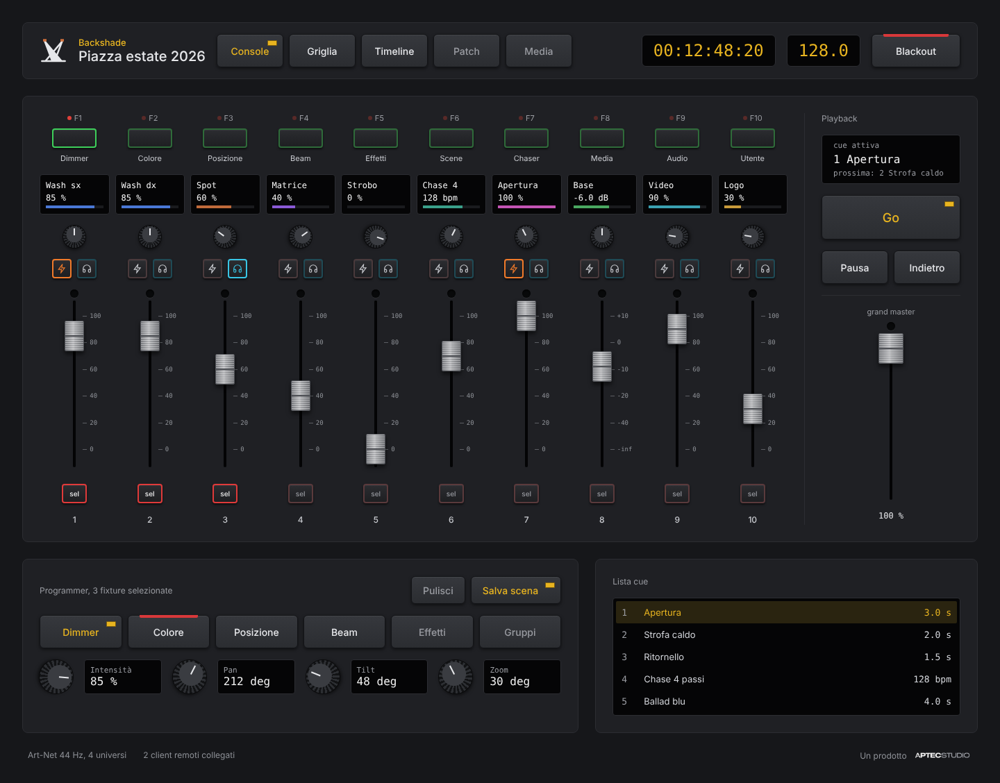
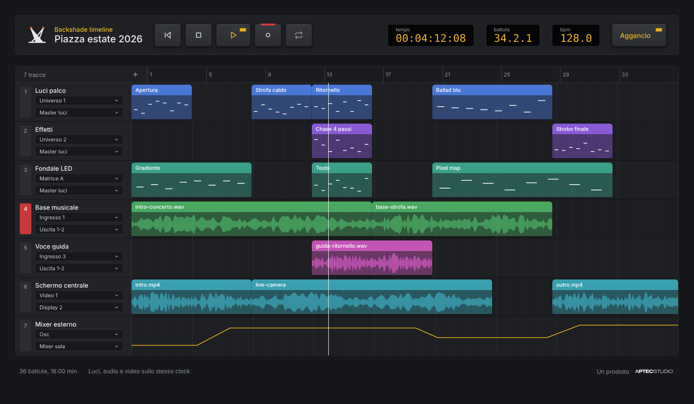

# Backshade design reference

Reference renderings of the Backshade interface, approved by the human on 2026-11-22. They are the starting point for the design system built in Phase 1 (see `ROADMAP.md`, item 1.4).

The files in this folder are a reference only: they are not application code and do not follow the ES5 rules of `/app`. Each screen is available as a PNG rendering and as a static HTML page to open in a browser.

## Screens

### Console (desktop)

Controller surface with function keys, channel strips (small display, knob, flash and solo keys, long fader with scale, select key), playback section with cue display, go key and grand master, programmer and cue list.

Page: [console.html](console.html)

### Track timeline (desktop)

DAW-style arrangement for pre-programmed shows: transport keys, time, bar and tempo displays, track headers with input and output selectors, colored clips with a header strip, light steps or waveforms, automation lane for the external mixer, white playhead.

Page: [timeline.html](timeline.html)

### Remote (mobile)

Web interface served on the local network: header with timecode, soft keys, four channel strips, blackout and go keys.

Page: [remote-mobile.html](remote-mobile.html)

## Rules

- The theme is always dark.
- Panels and cards are flat: background `#1f2024`, border `#2c2d32`, radius `8` px, on a `#16171a` surface.
- Controls are realistic: gradients and shadows are allowed only on faders, knobs, keys and displays.
- No glow: LEDs and states use solid colors.

## Components

### Soft keys

- Rounded rectangle, radius `6` px, height `48` px, light vertical gradient (`#36383d` to `#2b2d31`), soft drop shadow.
- Normal: light label `#e6e7ea`.
- Inactive: grey label `#9a9ca2`.
- Active: label in the accent `#e8b420` and a small accent LED in the top right corner.
- Armed or selected: a red bar `#d8383a` along the top edge.

### Square keys

- `28` px square, radius `4` px, `2` px colored outline that shows the state: flash orange `#f07a2a`, solo cyan `#39c6e6`, select red `#e03a3a`; dimmed outline when off.
- Line icon inside, or a short lowercase label such as "sel".

### Function keys

- Small key with a green outline (`#3ecf5a` active, `#2f6b3a` inactive), a status dot above and the label below.

### Displays

- Black screen `#050506` with a thin border, monospace text.
- Channel displays: name, value and a thin level bar in the channel color.
- Timecode and tempo: accent `#e8b420` digits.

### Knobs

- Dark round knob with a knurled edge and a light indicator line.

### Faders

- Thin black slot with a round end at the top and a printed scale on the right (`100` to `0` for lights, `+10` to `-inf` for audio).
- Grey, ribbed, slightly translucent cap wider than the slot, with a darker center line.

### Timeline clips

- Colored header strip with the clip name, body in the same color at lower opacity, rounded top corners.
- Light clips show steps, audio and video clips show a waveform, automation is a thin accent line.

## Palette

| Role | Value |
| --- | --- |
| Surface | `#16171a` |
| Panel | `#1f2024`, border `#2c2d32` |
| Text | `#e6e7ea`, secondary `#9a9ca2` |
| Accent | `#e8b420` |
| Armed | `#d8383a` |
| Channel colors | blue `#4a78d6`, orange `#c06a3a`, purple `#8a5ad6`, yellow `#c8a43a`, teal `#3aa08a`, pink `#c454b4`, green `#4aa860`, cyan `#3aa0b0`, amber `#c89a3a` |

## Source

The screens were designed on a Claude design canvas: [Backshade - bozza grafica](https://claude.ai/artifact/HLRQ26ymWZ4WZRd1CWPqqC) (private, visible to the owner unless shared). The HTML pages are static exports of that canvas.
